# Сводка новостей по фэндомам — октябрь 2026

By Kitty

## Новостные события

Всем привет! Я собрала для вас самые интересные новости по всем фэндомам. Будьте внимательны: некоторые фэндомы обладают высокой популярностью не только в США. Огоньком *🔥* я пометила самые интересные новости или то, что проверила у себя на предмет хороших просмотров. Пожалуйста, адаптируйте идеи под формат контента вашего канала (романтика не залетит на канале со страшилками и наоборот). Желаю вам больших просмотров!

### 1. Escape From Playtime — новая кооперативная хоррор-игра

26 августа Mob Entertainment анонсировала новую игру во вселенной Poppy Playtime. В отличие от основной серии, где игрок исследует заброшенную фабрику от первого лица, здесь главными героями становятся сами Smiling Critters — разноцветные игрушечные животные.

Игра рассчитана на 1–4 участников. Персонажам предстоит исследовать фабрику Playtime Co., собирать материалы, выполнять поручения загадочного голоса и одновременно прятаться от опасных игрушек.

**Ранний доступ запланирован на 21 октября**. В начале месяца также проходило открытое тестирование.

<aside markdown="1">
💡

Идеи:

CatNap, DogDay, CraftyCorn и Hoppy Hopscotch в игровых образах.

Милые игрушечные версии персонажей рядом с их пугающими игровыми противниками.

Милые игрушечные версии персонажей рядом с их альтернативными хоррор-версиями.

Игровой ролик (2 POV), где на одном аккаунте оба рисунка милые, а на втором аккаунте один из персонажей становится хоррор-версией.

Игровой ролик (2 POV), где на одном аккаунте персонаж Miss Delight выглядит мило в стиле аниме, а на втором проявляет хоррор-черты. Музыка: **Yaelokre — Harpy Hare**

</aside>

https://youtube.com/shorts/3e6THhkwOU4?si=lVQyv5lUCVc1jssJ

https://youtube.com/shorts/QBgbkOXESR0?si=lpXPVYAmpqYPZ_1C

### 2. FNAF × Fortnite — большая коллаборация к Хэллоуину

1 октября Epic Games запустила Fortnitemares 2026, в котором появились персонажи Five Nights at Freddy's.

Главная особенность коллаборации — появление классических аниматроников Freddy Fazbear, Bonnie, Chica и Foxy. Их костюмы могут получать боевые повреждения.

В игру добавили аниматроников-боссов. После победы над таким противником игрок может временно получить возможность управлять им и преследовать других участников.

Таким образом, персонажи FNAF используются не только как косметические костюмы, но и непосредственно участвуют в игровом событии.

<aside markdown="1">
💡

Идеи:

Freddy, Bonnie, Chica и Foxy в полный рост с оружием и аксессуарами Fortnite.

Обычные и повреждённые версии четырёх аниматроников.

Freddy пугает игрока Fortnite.

Хоррор-видео, где на одной половине стандартный урок, а на другой — Freddy, Bonnie, Chica или Foxy.

Сравнение классических FNAF-аниматроников и их игровых версий.

Игровой ролик (2 POV), где на одном аккаунте оба рисунка — красивые аниматроники, а на втором один из персонажей становится разрушенной/обгоревшей версией аниматроника.

</aside>

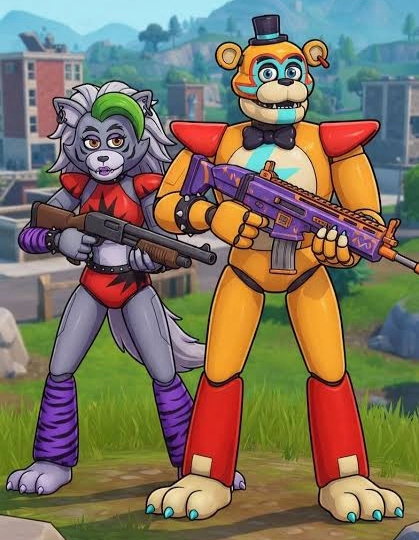

### 3. myPOPGOES — консольный релиз игры Fazbear Fanverse

8 октября myPOPGOES стала доступна на игровых консолях.

Это небольшая игра из программы Fazbear Fanverse, поддерживающей независимые проекты по мотивам Five Nights at Freddy's.

Главный персонаж — ласка Popgoes. Игра стилизована под виртуального питомца: за персонажем нужно ухаживать, кормить его, развлекать и открывать мини-игры.

Несмотря на милый внешний вид, проект связан со вселенной хоррор-игр POPGOES.

<aside markdown="1">
💡

Идеи:

Милая версия ласки POPGOES и её хоррор-версия.

Пиксельная версия POPGOES vs рисованная версия.

Игровой ролик (2 POV), где на одном аккаунте оба рисунка — милые версии ласки, а на втором один из рисунков становится разрушенной/обгоревшей версией аниматроника.

</aside>

### 4. Minecraft Dungeons II — новая официальная игра

Minecraft Dungeons II — новая приключенческая игра во вселенной Minecraft, которая вышла 29 сентября 2026 года.

В отличие от обычного Minecraft, где игроки строят дома и исследуют мир, здесь главная задача — сражаться с монстрами, искать сокровища и побеждать опасных боссов.

По сюжету группа героев отправляется спасать мир от новых злодеев — совета злых существ, называемых илладжерами. В игре появились новые монстры, необычные локации и загадочное измерение The Sift, наполненное фантастическими существами.

<aside markdown="1">
💡

Идеи:

Пиксельная версия существа vs реалистичная версия.

На уроке с пиксельной лягушкой: нарисовать существо и разыграть идею со сломанным (серым) iPad.

На уроке с пиксельной лягушкой: половина крипера/зомби/скелета в обычной версии, а половина — в голубой (алмазной) версии.

Нарисовать битву между магом (злодеем) и одним из главных героев, используя анимированные кисти для эффектов.

</aside>

### 5. The Sift — четвёртое измерение Minecraft

На Minecraft Live 2026 Mojang представила The Sift — измерение, которое сначала появилось в Minecraft Dungeons II.

В отличие от старых измерений, The Sift представляет собой необычное пространство с яркой растительностью, душами, загадочными существами и изменённой физикой окружения.

Mojang также объявила, что в 2027 году измерение появится в Minecraft Java и Bedrock Edition.

Это первое объявленное новое измерение основной игры более чем за 14 лет.

<aside markdown="1">
💡

Идеи:

Идея 1. Разыграть старый мем с порталом в рай:

1. Нарисовать на одной половине портал в ад, на другой — портал в рай.
2. Удивиться: «О, что за этими порталами?»
3. Внутри портала в ад нарисовать огонь, внутри портала в рай — воду.
4. Склейка. Портал в ад внутри фиолетовый, портал в рай — голубой.
5. Стереть внутреннюю часть своего портала и показать существо за ним: если портал в ад — существо из ада, если портал в рай — из измерения The Sift. Или нарисовать сами миры.
6. Попросить найти второе POV с тем, что спрятано за вторым порталом.

Другие идеи:

Нарисовать новых существ на уроке с пиксельной лягушкой.

Пиксельная версия vs реалистичная версия.

</aside>

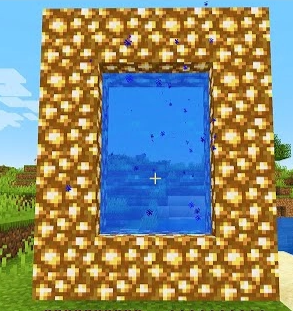

### 6. Frostbite — новый замёрзший зомби

В начале октября Minecraft получила тестовое обновление с ледяными пещерами и новыми существами.

Среди новых противников — Frostbite, замёрзший вариант обычного зомби.

Этот монстр приспособлен к холодным биомам и использует ледяные снаряды, способные замораживать игрока.

<aside markdown="1">
💡

Идеи:

Пиксельная версия существа vs реалистичная версия.

На уроке с пиксельной лягушкой: нарисовать существо и разыграть идею со сломанным (серым) iPad.

На уроке с пиксельной лягушкой: половина зомби в обычной версии, а половина — в зимней версии.

</aside>

### 7. *🔥* Twixxel — новая серия Minecraft-хоррора о Creator

10 октября вышла вторая часть Minecraft-хоррора Twixxel под названием *Something Is Still Here*.

История посвящена загадочному существу Creator. Это сверхъестественный персонаж, который вмешивается в игровой мир, преследует героев и обладает знаниями, недоступными обычному игроку.

В создании проекта участвовали представители сообщества Minecraft-хорроров, включая ThatMob.

*(Шипперский контент вызывает бурные споры в комментариях и нравится не всем, но набирает хорошие просмотры.)*

<aside markdown="1">
💡

Идеи:

Twixxel и Creator лицом друг к другу.

Хоррор-версия Creator vs его человеческая версия.

Романтическая ситуация: Twixxel × Creator.

</aside>

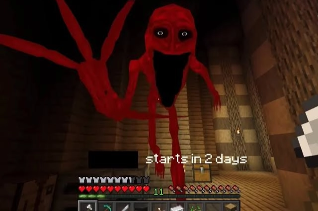

### 8. *🔥* «Your Verity» — новая совместная песня CG5 и Horror Skunx

19 сентября популярный музыкальный исполнитель CG5 совместно с Horror Skunx выпустил песню «Your Verity», посвящённую персонажу Minecraft-хоррора ютубера ThatMob.

Verity — загадочный искусственный интеллект, который выглядит как дружелюбный жёлтый шар с улыбающимся лицом. Он стремится подружиться с игроком, но постепенно становится навязчивым и опасным. В новой песне особенно раскрывается его желание обрести друга и страх остаться в одиночестве.

Песня завирусилась в октябре и набрала более 7 миллионов просмотров.

Особенно хорошо работает с **контентом в шипперском стиле.**

Помимо хоррор-сюжета, поклонники начали изображать Verity и его создателя ThatMob как романтическую пару. В таких фанатских анимациях страшный персонаж часто становится милым, ревнивым или чрезмерно привязанным к ThatMob.

*(Шипперский контент вызывает бурные споры в комментариях и нравится не всем, но набирает хорошие просмотры.)*

<aside markdown="1">
💡

Идеи:

ThatMob обнимает Verity.

Verity ревнует ThatMob к другим персонажам.

Контраст: страшный Verity рядом с ThatMob неожиданно становится дружелюбным.

Контраст: страшный Verity vs красивая человеческая форма.

</aside>

### 9. *🔥* Minecraft — GroxMC × Froggy Dude (Frox / Groggy)

GroxMC и Froggy Dude — персонажи Minecraft-роликов двух популярных ютуберов. Grox изображает себя жестоким и самовлюблённым правителем, который заставляет жителей Minecraft работать на него, платить налоги и выполнять абсурдные приказы. Froggy Dude, напротив, выступает в роли непокорного героя, который пытается выжить в мире Grox и противостоять его власти.

Их противостояние стало основой фанатского шипа **Frox**.

У GroxMC есть несколько узнаваемых фраз, которые поклонники используют в мемах, фанатских анимациях и шипперском контенте.

Самые характерные:

1. «AYO CHILL!!!» — «Эй, полегче!» Самая узнаваемая фраза Grox. Обычно он выкрикивает её, когда происходит что-то неожиданное, опасное или неловкое.
2. «Aight bet!» — «Ладно, по рукам!» Говорит, когда принимает вызов или соглашается на какую-нибудь безумную затею.
3. «Let's get LITTT!!» — «Давайте зажжём!» Эмоциональный возглас перед началом веселья или хаоса.
4. «Dear God...» — «Боже мой...» Реакция на происходящий абсурд.

*(Шипперский контент вызывает бурные споры в комментариях и нравится не всем, но набирает хорошие просмотры.)*

<aside markdown="1">
💡

Идеи:

GroxMC и Froggy Dude вместе.

Один из ютуберов пиксельный, а второй — красивый в реалистичном стиле.

Мемы с ютуберами.

</aside>

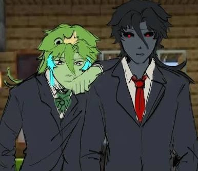

### 10. *🔥* Helluva Boss — третий сезон

Премьера третьего сезона Helluva Boss запланирована на 14 октября.

Это взрослый анимационный сериал Вивьен Медрано о небольшой компании демонов I.M.P., которые работают наёмными убийцами и выполняют заказы в мире людей.

В центре истории находится Blitzø, руководитель компании. Значительную роль играют его сложные романтические отношения со Stolas — демоном аристократического происхождения.

Другие важные персонажи — Millie, Moxxie и Loona.

Важные темы нового сезона:

1. Беременность Millie.
2. Красные глаза у Blitzø (красные глаза — признак истинной ярости или цвет глаз адских гончих, например Loona, и высших демонов, например Stolas, тогда как Blitzø — обычный бес/имп).
3. Дружба Loona и Octavia.
4. Отношения Stolas и Blitzø.
5. Отношения Stolas с другом детства — Vassago.

Первую часть нового сезона планируется выпускать в октябре: три серии 14 октября, две — 21 октября и две — 28 октября.

<aside markdown="1">
💡

Идеи:

Blitzø и Stolas вместе.

Millie в бойцовской позе.

Millie и Moxxie.

Loona в новом образе.

</aside>

### 11. Spooky Month 7 — новая серия Sr Pelo

В начале октября вышел седьмой эпизод Spooky Month — популярного анимационного хоррор-сериала художника Sr Pelo.

Главные герои мультфильма — два ребёнка, Skid и Pump, которые обожают Хэллоуин и круглый год ведут себя так, будто праздник никогда не заканчивается.

За внешне простой комедийной историей скрываются более мрачные элементы: культы, демоны, мистические существа и загадочные события.

После выхода новой серии поклонники начали обсуждать её новых персонажей, загадочное кольцо и возможную связь происходящего с семьёй Skid.

Главная злодейка нового эпизода — **Aspen Moor**, жуткая демоническая ведьма, которая заманивает детей в созданный ею волшебный мир. Сначала всё выглядит как весёлая сказка с играми и развлечениями, но постепенно выясняется, что ведьма использует иллюзии, чтобы отвлекать детей и похищать их души.

Её образ сочетает внешнюю сказочность и настоящий хоррор. Ведьма способна создавать галлюцинации, превращать происходящее в кошмар и принимать пугающий облик. В финале после разрушения её талисмана тело ведьмы превращается в дерево.

<aside markdown="1">
💡

Идеи:

Aspen Moor в её основном облике и страшная демоническая версия ведьмы.

Skid и Pump танцуют.

Skid и Pump против ведьмы (бросают снежки).

</aside>

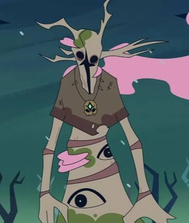

### 12. Knights of Guinevere — Episode 2: Wolves Around The Corner

9 октября GLITCH Productions выпустила вторую серию нового анимационного проекта.

Knights of Guinevere — научно-фантастический психологический хоррор, созданный при участии Dana Terrace, известной по The Owl House.

Действие происходит в необычном футуристическом мире, где существует огромный парк развлечений и роботизированная принцесса Guinevere.

Сюжет сочетает искусственный интеллект, научную фантастику, психологические травмы и мрачную сказочную эстетику.

<aside markdown="1">
💡

Идеи:

Guinevere в человеческом и повреждённом роботизированном облике (можно снять 2 POV, где в первом видео Guinevere в красивой форме, а во втором — в повреждённой).

Главных героинь вместе.

Героинь в рыцарской броне.

</aside>

### 13. Avatar: Seven Havens — новый мультсериал

9 октября Paramount+ выпустил первые три серии Avatar: Seven Havens — нового продолжения вселенной «Аватара».

Действие разворачивается спустя 225 лет после событий «Легенды о Корре».

Мир пережил катастрофу и теперь состоит из семи крупных укреплённых поселений. В отличие от прежних эпох, люди боятся Аватара и считают его угрозой для человечества.

Главная героиня — маленькая девочка Pavi, владеющая магией земли. Она узнаёт, что стала следующим Аватаром после Корры.

Важные персонажи — её сестра-близнец Nisha, Jae и животное-компаньон Geet.

На New York Comic Con также объявили о продлении мультсериала на третью и четвёртую книги.

<aside markdown="1">
💡

Идеи:

Pavi в полный рост.

Pavi использует магию земли.

Pavi и Nisha вместе.

Pavi рядом с Aang и Korra — три поколения Аватаров.

Geet как отдельный милый персонаж.

</aside>

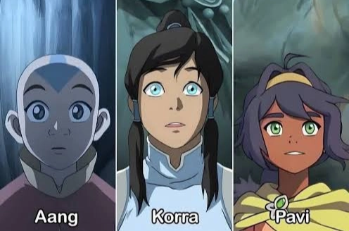

### 14. Avatar Kuruk: Wave of Chaos — новый анимационный проект

9 октября Paramount+ представил новый мультсериал об Аватаре Kuruk.

Kuruk — Аватар из Северного Племени Воды, живший задолго до Aang и Korra.

В новом мультсериале покажут его молодость, путешествия, обучение магии и столкновения с духами.

Главным животным-компаньоном станет Nikik — необычное существо, напоминающее смесь коалы и выдры.

<aside markdown="1">
💡

Идеи:

Kuruk использует магию воды рядом с Korra.

Kuruk вместе с Nikik.

Kuruk против злых духов.

Aang, Korra, Pavi и Kuruk вместе.

</aside>

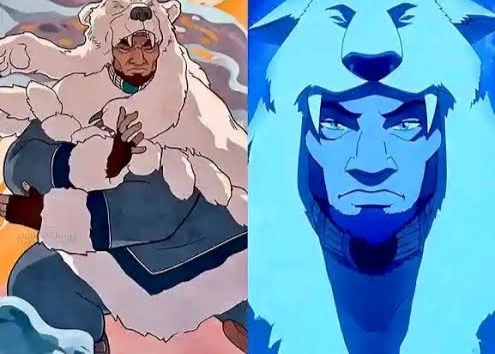

### 15. The Summoning — хэллоуинский эпизод (Латинская Америка!)

6 октября в Латинской Америке запланирован показ хэллоуинского эпизода нового сериала о Гамболе.

По сюжету Darwin оказывается вовлечён в деятельность ведьмовского ковена и начинает экспериментировать с магическими способностями.

Постепенно магия приводит к неожиданным последствиям.

Важно учитывать, что для американских зрителей эпизод мог быть доступен раньше, поскольку второй сезон уже выходил на Hulu.

<aside markdown="1">
💡

Идеи:

Darwin в костюме вместе с девочками.

Gumball и Darwin с магией.

Carrie и Darwin со смешными лицами.

</aside>

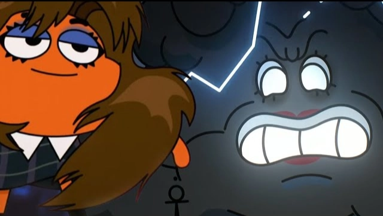

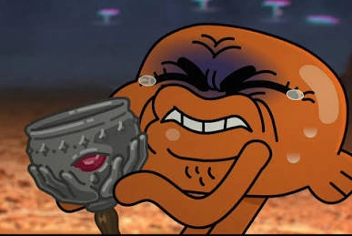

### 16. Phineas and Ferb — Halloween Special

В октябрьском расписании Disney упоминался новый хэллоуинский выпуск «Финеса и Ферба».

Главные герои — два сводных брата Phineas и Ferb, которые постоянно создают невероятные изобретения.

Параллельно утконос Perry ведёт тайную жизнь секретного агента и сражается с доктором Doofenshmirtz.

<aside markdown="1">
💡

Идеи:

Phineas и Ferb в хэллоуинских костюмах.

Perry the Platypus и Doofenshmirtz — мем.

</aside>

### 17. Avengers: Endgame Encore — возвращение фильма

Marvel представила повторный кинотеатральный выпуск Avengers: Endgame с дополнительными материалами, связанными с будущим Avengers: Doomsday.

В новом Doomsday Роберт Дауни-младший играет уже не Железного человека, а Доктора Дума. Поэтому фэндом снова обсуждает смерть Тони Старка, путешествия во времени и пытается понять, как Endgame будет связан с Doom.

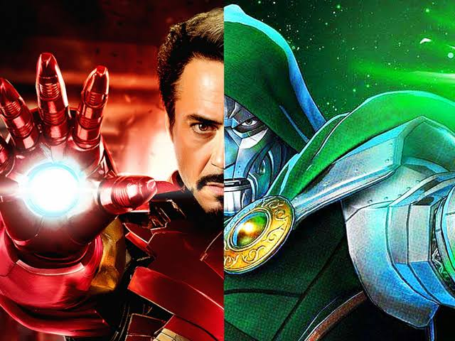

### 18. Wildwood — новый мультфильм студии LAIKA

11 октября состоялся фестивальный показ нового кукольного мультфильма студии LAIKA, известной по легендарному мультфильму «Коралина в Стране Кошмаров».

Wildwood — мрачная фэнтезийная история о девочке Prue McKeel, которая отправляется в загадочный лес, чтобы спасти младшего брата.

Мир наполнен говорящими животными, опасными существами и волшебством.

<aside markdown="1">
💡

Идеи:

Снова порисовать арты по «Коралине»:

Coraline и Другая Мама.

Coraline с обычными глазами на одной стороне и глазами-пуговицами на другой.

Арты по новому мультфильму:

Prue рядом с персонажами Coraline — как межфэндомный рисунок.

Prue McKeel и Alexandra Svik.

</aside>

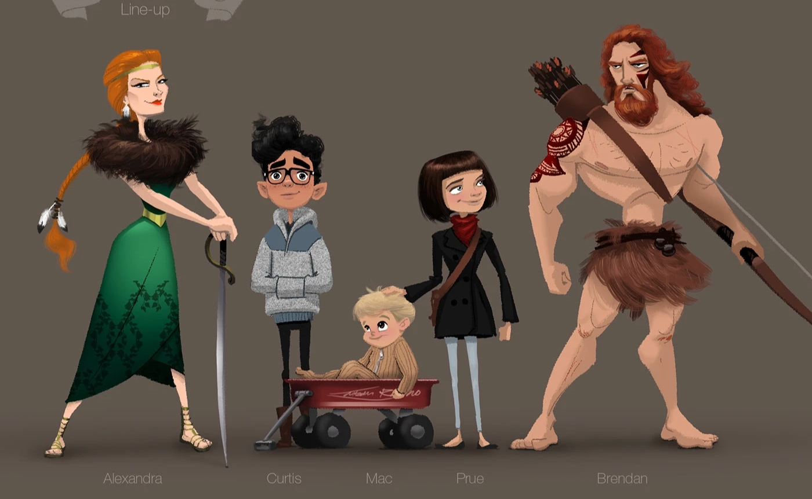

### 19. Pokémon Pokopia — Halloween Event

30 сентября сообщалось о тематическом событии с Pumpkaboo, связанном со сбором конфет и осенними украшениями.

Pumpkaboo — покемон, напоминающий ожившую тыкву. Он хорошо вписывается в хэллоуинскую эстетику Pokémon.

<aside markdown="1">
💡

Идеи:

Нарисовать покемона в обычном и редком цвете.

Нарисовать покемона и его эволюцию.

</aside>

### 20. Pokémon GO — Zorua Community Day

В октябре появились сообщения о Дне сообщества, посвящённом Zorua.

Zorua — маленький тёмный покемон-лис, который способен принимать облик других существ.

Его эволюция — Zoroark.

<aside markdown="1">
💡

Идеи:

- Zorua и Zoroark вместе.
- Zorua и Pikachu.
- Обычная и блестящая версии Zorua.
</aside>

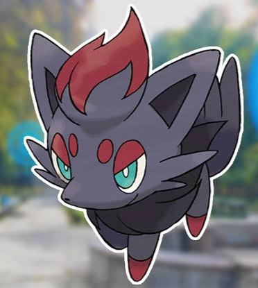

### 21. Pokémon Horizons — новый сезон Wonders Ahead

6 октября появились новости о продолжении Pokémon Horizons.

Релиз следующего сезона на Netflix запланирован на 27 февраля 2027 года.

<aside markdown="1">
💡

Идеи:

Liko и Sprigatito.

Roy и Fuecoco.

</aside>

### 22. 🔥 The Apothecary Diaries — третий сезон

2 октября 2026 года стартовал третий сезон популярного аниме «Монолог фармацевта» (The Apothecary Diaries). На данный момент вышли две серии — 2 и 9 октября. Новые эпизоды выходят каждую пятницу, а в апреле 2027 года начнётся вторая половина сезона.

Главная героиня — Маомао, девушка, которая прекрасно разбирается в лекарствах, ядах и болезнях. Благодаря своим знаниям она раскрывает загадочные происшествия при императорском дворе. Её постоянный спутник — загадочный красавец Цзиньши, который скрывает своё настоящее происхождение и испытывает к Маомао романтические чувства.

В третьем сезоне история постепенно выходит за пределы императорского дворца. Стране угрожают природные бедствия, появляется таинственная жрица, а Цзиньши приходится принимать обязанности младшего брата императора. Маомао и Цзиньши предстоит столкнуться с новыми загадками, политическими интригами и опасностями.

<aside markdown="1">
💡

Идеи:

Маомао и Цзиньши вместе.

Маомао в новых костюмах третьего сезона.

Таинственная жрица из нового сезона.

Адо и Императрица с детьми (Адо подменила детей, и Цзиньши — не брат императора, а его сын. Это подтвердил опенинг).

</aside>

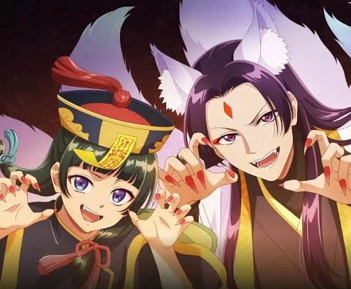

### 23. 🔥 «Монолог фармацевта» — новые трейлеры полнометражного фильма

11 октября 2026 года создатели «Монолога фармацевта» начали публикацию четырёх новых трейлеров полнометражного фильма *The Apothecary Diaries: The Secret Treasure of the Deceased Consort* («Тайное сокровище покойной наложницы»). Премьера фильма в Японии состоится **11 декабря 2026 года**.

Это будет первая полнометражная картина во вселенной «Монолога фармацевта» с совершенно новой историей, написанной специально для фильма при участии автора оригинальных романов Нацу Хюги.

По сюжету Маомао и Цзиньши отправляются в загадочный город на воде, чтобы расследовать обстоятельства смерти наложницы, умершей пять лет назад. Её последняя просьба вызывает подозрения, а расследование постепенно раскрывает тайны влиятельной семьи, связанные с сокровищем, опасными лекарствами и нападениями речных разбойников.

В новых трейлерах показали знакомых героев — Маомао, Цзиньши, Гаошуня, Лаханя, Ракана и других. Также представлены новые персонажи из клана Би и группировка водных разбойников Кадзя, чей предводитель Суйдзя получил отдельного актёра озвучивания.

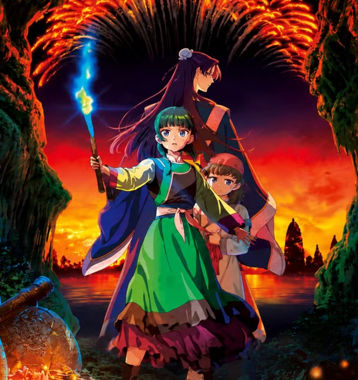

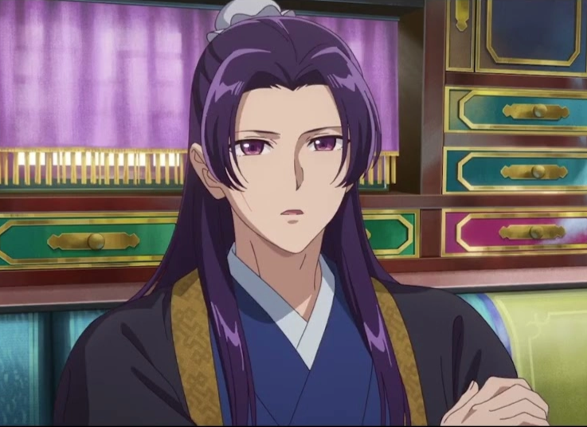

### 24. Buddy — хоррор про единорога: видео к Хэллоуину

28 августа вышел новый хоррор-фильм Buddy режиссёра Casper Kelly.

Главный герой — оранжевый единорог Buddy, ведущий вымышленного детского телешоу *It's Buddy!*.

На первый взгляд он кажется дружелюбным и милым, но за его внешностью скрывается опасный персонаж, который жестоко реагирует на непослушание.

После выхода фильма вокруг Buddy начали появляться фанатские иллюстрации и интерпретации.

Другие хоррор-идеи к Хэллоуину можно посмотреть в бестиарии.

[Бестиарий монстров](../articles/bestiary_monsters.md)

### 25. KATSEYE: Wild Hearts — новый документальный фильм

6 октября Disney+ и Hulu выпускают документальный фильм о группе KATSEYE.

KATSEYE — международная женская музыкальная группа, образованная благодаря проекту Dream Academy.

В состав входят Sophia, Manon, Daniela, Lara, Megan и Yoonchae.

Фильм рассказывает об участницах, их творчестве, подготовке выступлений и отношениях с поклонниками EYEKONS.

<aside markdown="1">
💡

Идеи:

Порисовать участниц группы.

Активно использовать их музыку в видео.

</aside>

### 26. The Love Hypothesis — экранизация романа

В октябре появились материалы и первые рецензии на экранизацию популярного романтического романа Али Хейзелвуд.

Главная героиня — Olive Smith, аспирантка, которая неожиданно начинает изображать романтические отношения с молодым преподавателем Adam Carlsen.

В фильме главные роли исполняют Lili Reinhart и Tom Bateman.

<aside markdown="1">
💡

Идеи:

Olive и Adam вместе.

Olive в лабораторном халате.

Adam и Olive в романтической сцене.

Olive с книгами и научными принадлежностями.

</aside>

### 27. Adventure Time: Side Quests — вышел второй сезон «Времени приключений»

2 октября 2026 года на Disney+ и Hulu состоялась премьера второго сезона мультсериала *Adventure Time: Side Quests*. 5 октября новые серии также начали показывать на Cartoon Network и HBO Max за пределами США.

«Время приключений» возвращается к своим истокам: главные герои — мальчик Финн и его лучший друг, волшебный пёс Джейк. Вместе они путешествуют по фантастической стране Ууу, сражаются с необычными монстрами, знакомятся с волшебными существами и постоянно попадают в абсурдные ситуации.

Новый мультсериал рассказывает о ранних приключениях Финна и Джейка, когда они были моложе. Каждая серия представляет собой самостоятельную историю. Во втором сезоне герои сражаются с жабами-рестлерами, встречают маленьких гладиаторов и оказываются под действием странных заклинаний.

В мультсериал также возвращаются знакомые персонажи: Принцесса Бубльгум, Марселин, Ледяной Король и БиМО.

<aside markdown="1">
💡

Идеи:

Молодые Финн и Джейк в новых образах из Side Quests.

Финн с мечом и Джейк в одной из его необычных форм.

Жабы-рестлеры из второго сезона.

Маленькие гладиаторы из новых серий.

Принцесса Бубльгум и Марселин вместе.

Ледяной Король в новых сценах.

БиМО — маленький живой игровой робот.

Сравнение Финна и Джейка из оригинального мультсериала и Side Quests.

Все главные персонажи нового сезона вместе.

</aside>

### 28. Dandy's World — большое хэллоуинское обновление 2026

2 октября 2026 года в популярной Roblox-игре Dandy's World началось масштабное хэллоуинское событие, которое продлится до 6 ноября. Разработчики вернули праздничных персонажей, добавили новые костюмы, страшные локации и необычные игровые механики.

Dandy's World — кооперативная хоррор-игра, в которой игроки управляют милыми мультяшными существами, называемыми Toons. Они исследуют заброшенный развлекательный центр Gardenview, выполняют задания и пытаются выжить, избегая встреч с Twisted — жуткими искажёнными версиями персонажей.

Главные герои хэллоуинского события — четыре праздничных персонажа:

- **Gourdy** — ожившая тыква, которая заведует хэллоуинским магазином. В этом году вокруг него появилась дополнительная загадка с семью частями таинственной шкатулки.
- **Eclipse** — персонаж, связанный с луной и оборотнями. Во время отключения света может превращаться в более сильную форму.
- **Soulvester** — призрачный рыцарь в доспехах. В обновлении его способности переработали.
- **Ribecca** — оживший скелет, получивший изменения способностей и новые визуальные эффекты.

<aside markdown="1">
💡

Идеи:

Goob в новом костюме Fuzzy Beast.

Scraps в костюме Wicked Stitch.

Waxwell в костюме Toxic Experiment.

Милые персонажи и их искажённые версии.

</aside>

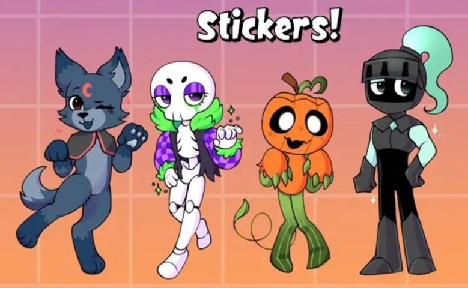

### 29. Adopt Me! — Halloween 2026: новые питомцы и отель с привидениями

В Adopt Me! началось большое хэллоуинское событие с новыми питомцами, особняком призраков, подземным склепом и опасным отелем.

Adopt Me! — популярная Roblox-игра, в которой игроки коллекционируют необычных животных, ухаживают за ними, украшают дома и обмениваются питомцами. На Хэллоуин разработчики традиционно добавляют ограниченные коллекции фантастических существ.

3 октября появился Ghost Gallery — особняк, где игроки с помощью специального устройства ловят привидений, вселяющихся в мебель. В подземном склепе можно найти Mummy Spider — мумифицированного паука.

9 октября открылась вторая часть события — Hauntlet 2. Игроки исследуют пугающий отель, выбирают двери, избегают ловушек и призраков. Новым управляющим отеля стал Bolt, который намеренно даёт посетителям ложные подсказки.

<aside markdown="1">
💡

**Главные новые питомцы:**

**Skelicorn** — единорог-скелет, которого можно оживить, найдя специальный электрический рычаг в склепе. Легендарный питомец.

**Jester Dragon** — дракон-шут с карнавальной внешностью. Легендарный питомец.

**Bolt** — необычный механический персонаж, новый служащий проклятого отеля.

**Mummy Spider** — паук-мумия, которого находят в склепе.

**Jumpscare** — призрачное существо, связанное с особняком.

**Bubblegeist, Bobageist и Caramelgeist** — три разновидности маленьких привидений, которых можно получить из Poltergeist Box.

</aside>

### 30. 99 Nights in the Forest — Halloween Begins

17 октября в Roblox-хорроре 99 Nights in the Forest должно начаться большое хэллоуинское событие Halloween Begins.

99 Nights in the Forest — игра на выживание, в которой участники оказываются посреди загадочного леса. Им нужно поддерживать костёр, строить укрепления, искать пропавших детей и пережить 99 ночей, скрываясь от опасных существ.

Самый узнаваемый монстр игры — The Deer, жуткий олень с вытянутым телом, который появляется в темноте и преследует игроков. Среди других известных существ — The Owl и The Ram.

Подготовка к Хэллоуину началась ещё 3 октября с обновления Helping Happy. В игру вернулся персонаж Happy the Halloween Guy, появились новые задания, коса Happy's Scythe и награды, включая Vampire Cloak.

Основное хэллоуинское событие запланировано на 17–24 октября. Разработчики пока не раскрыли полный состав новых противников.

<aside markdown="1">
💡

**Ключевые и самые известные персонажи**

Happy the Halloween Guy — персонаж октябрьского обновления.

Happy с его косой Happy's Scythe.

The Deer — главный страшный олень из игры.

The Owl — сова-монстр.

The Ram — жуткий баран.

</aside>

### 31. DOORS — The Candy Vault

22 октября в популярном Roblox-хорроре DOORS должно начаться новое событие The Candy Vault («Конфетное хранилище»).

DOORS — игра, в которой участники проходят через последовательность загадочных комнат и дверей, избегая встреч с опасными существами. Монстры обладают разными способностями, и для выживания игрокам приходится запоминать правила поведения при встрече с каждым из них.

Разработчики LSPLASH добавили The Candy Vault в официальный календарь мероприятий Roblox. Пока известны название события и дата его начала, но подробности новых монстров, наград и механик ещё не раскрыты.

<aside markdown="1">
💡

**Ключевые и самые известные персонажи, которых можно нарисовать:**

- Figure — высокий монстр без глаз с огромной пастью.
- Seek — чёрное существо с одним глазом.
- Rush — страшное лицо, возникающее в темноте.
- Ambush — зелёный призрачный монстр.
- Screech — маленькое тёмное существо с щупальцами.
- Figure и Seek вместе.
</aside>

Другие хоррор-идеи к Хэллоуину можно посмотреть в бестиарии.

[Бестиарий монстров](../articles/bestiary_monsters.md)

### 32. Dress to Impress — Halloween 2026

17 октября в Dress to Impress запланировано большое хэллоуинское обновление.

Dress to Impress — популярная игра Roblox, в которой участники создают образы моделей, подбирают одежду, причёски и макияж, а затем выходят на подиум. Другие игроки оценивают их костюмы.

Хэллоуинское обновление посвящено созданию страшных, готических и фантастических образов. Официальная страница игры подтверждает дату выхода крупного события, но полный список новых костюмов, причёсок и дополнительных персонажей пока не опубликован.

Особый интерес для фэндома представляют образы, связанные с историей Lana — загадочной девушки, вокруг которой в Dress to Impress построена отдельная сюжетная линия.

<aside markdown="1">
💡

**Ключевые и самые известные персонажи**

Lana в хэллоуинском образе.

Lina — персонаж, связанный с историей Lana.

Lana и Lina вместе.

Lana в страшной фанатской версии.

Модели Roblox в костюмах ведьм, вампиров и призраков.

Модели в готических платьях.

**Примечание:** конкретные новые наряды 2026 года стоит добавлять после официального показа обновления.

</aside>

### 33. Boisvert Analog Horror Game — мобильная игра с монстром Room

В 2026 году на Android и iOS стала доступна мобильная хоррор-игра *Boisvert Analog Horror Game*, основанная на интернет-хорроре *_boisvert*.

Главный монстр игры — **Room**, жуткое чёрное существо с длинными конечностями и огромной треугольной головой. Персонаж известен по необычным чёрно-белым анимациям, в которых практически отсутствуют привычные диалоги, а страшные образы сопровождаются тревожными звуками и загадочными сообщениями.

В игре человек оказывается заперт в заброшенном доме, где должен пережить пять ночей. Ему необходимо наблюдать за комнатами через камеры, разгадывать загадки и прятаться от Room, который постепенно становится всё опаснее.

Игра использует эстетику старых видеокассет, помехи на экране и резкие появления монстра. В описании также упоминаются другие персонажи вселенной Boisvert — Ouriel и Dogtooth.

На Google Play игра набрала более миллиона установок.

<aside markdown="1">
💡

**Что можно нарисовать:**

Room в полный рост — чёрный силуэт с огромной треугольной головой.

Room с пугающей улыбкой и белыми зубами.

Ouriel — светлый персонаж с необычной головой и рогами.

Dogtooth — ещё одно существо из вселенной Boisvert.

Room и Ouriel вместе.

Несколько монстров аналоговых хорроров вместе: Room, The Boiled One и другие.

</aside>

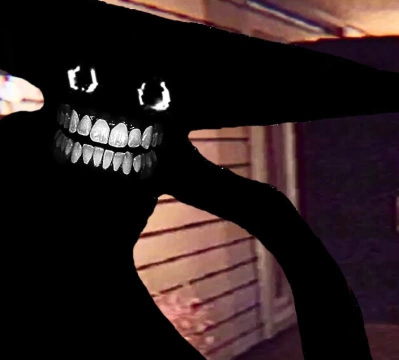

### 34. Идеи от других контент-ферм

#### 1. Jerry and LookOut3D Red Line Trend (Minecraft Animation)

**Jerry Dog**

Джерри — жуткий волк из Minecraft-хоррора Something Is Wrong With My Dog, созданного ютубером LookOut3D. Сначала он выглядит как обычный приручённый волк, который умеет выполнять команды игрока. Постепенно Джерри начинает вести себя странно, а его морда и глаза приобретают пугающий вид. Позже выясняется, что за обликом питомца скрывается опасная демоническая сущность.

**LookOut3D**

LookOut3D — Minecraft-ютубер, создающий игровые истории, необычные эксперименты и хоррор-сериалы. На его втором канале LookOut2DD 10 сентября 2026 года вышел первый эпизод Something Is Wrong With My Dog, положивший начало истории Джерри. В роликах LookOut выступает главным героем, который приручает волка и постепенно обнаруживает, что с его питомцем происходит нечто страшное.

Тренд: на одной стороне нужно нарисовать Minecraft-персонажа, а на другой — Джерри. Красная линия между ними показывает, что они связаны.

Музыка: страшная.

#### 2. Calm and angry trend Sprunki

Sprunki — популярная фанатская музыкальная игра по мотивам Incredibox, в которой игроки создают мелодии, комбинируя звуки забавных разноцветных персонажей. У каждого героя есть своё имя, внешность, характер и уникальный звук, благодаря чему персонажи быстро стали узнаваемыми. Главная особенность игры — возможность переключиться в хоррор-режим, где милые герои превращаются в жутких существ с искажёнными лицами и кровавыми деталями. Вокруг Sprunki сформировался большой фэндом, который создаёт анимации, фанатские истории, альтернативные вселенные и собственные версии персонажей.

**Очеловечивание персонажей и шипперский контент**

Со временем поклонники Sprunki начали рисовать персонажей в человеческом облике, сохраняя их узнаваемые цвета, причёски, аксессуары и черты характера. Художники стали придумывать героям собственные истории, характеры и взаимоотношения, превращая простых музыкальных персонажей в участников романтических и драматических сюжетов. Особенно распространились шипперские рисунки и анимации с парами Gray × Wenda, Oren × Pinki и другими сочетаниями, причём фанаты часто изображают их влюблёнными, ревнивыми или переживающими трагические события из хоррор-версии игры.

В тренде на одной стороне рисуется персонаж со шкалой спокойствия, а на другой — со шкалой злости. Эмоции персонажа зависят от положения шкалы. Можно использовать разных героев.

https://www.youtube.com/shorts/popFYD8hI3Y

https://www.youtube.com/shorts/pH9onyWq2EU

#### 3. Perfect World trend

Анимационный тренд, в котором ключевую роль играет песня. Можно изображать трёх персонажей, ориентация одного из которых «выбивается из нормы» для окружающих, из-за чего его положение рядом с парой становится трагичным. В одном POV товарищи могут его принять, а в другом — нет.

Можно также поднять тему расизма, например перерисовать расистскую иллюстрацию в толерантном ключе. Другой вариант — нарисовать шипперскую пару из фэндома (например, Жемчуг и Роза Кварц/Розовый Алмаз). Можно затронуть и тему веса. Подходят любые фэндомы.

Тренд популярен в США из-за тематики меньшинств.

Музыка обязательно: Perfect System · Oingo Boingo.

https://youtube.com/shorts/TKSbk2UrHsg?si=ymZxmx-J12k5SKyO

https://www.youtube.com/shorts/ULQjP21ZHwk

https://www.youtube.com/shorts/5xNoyB3GFdc

#### 4. Buggin trend

В конце сентября 2026 года завирусился фрагмент песни *She Bugging (Whatchu Gonna Do)* американского рэпера Khantrast. Популярность пришла после его выступления на канале Genius, где он эмоционально исполнил припев «Baby, you buggin’» — на сленге это примерно означает «Ты вообще с ума сошёл?». Звук быстро распространился в TikTok.

В TikTok под эту песню обычно просто рисуют персонажей любого фэндома в определённой позе.

Музыка обязательно: *She Bugging — Khantrast*.

<aside markdown="1">
💡

Кого рисовать:

Популярных западных VTuber.

Популярных персонажей из Genshin Impact и ZZZ.

Женских персонажей из Sprunki.

Roblox-персонажей и блогеров.

Персонажей из «Магической битвы».

Персонажей Deltarune.

Фурри.

Winx.

Человеческие версии персонажей MLP.

Персонажей из аниме «Клинок, рассекающий демонов».

Девочек из KPop Demon Hunters.

</aside>

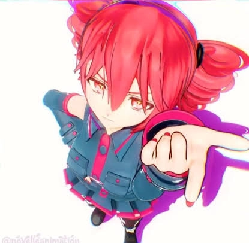

#### 5. Buggin × NewJeans — JJK YouTube trend

На YouTube сильно завирусились видео под ремикс трека **Buggin** с персонажами аниме «Магическая битва».

Можно нарисовать популярных персонажей из этого аниме и добавить в YouTube аудио из оригинального видео.

https://www.youtube.com/shorts/Ur8ohIarD_s

https://www.youtube.com/shorts/p475a1a-YBY

---

---

---

Спасибо за внимание ❤❤❤❤❤❤❤

Надеюсь, эта статья вдохновит вас на создание крутых видео!
